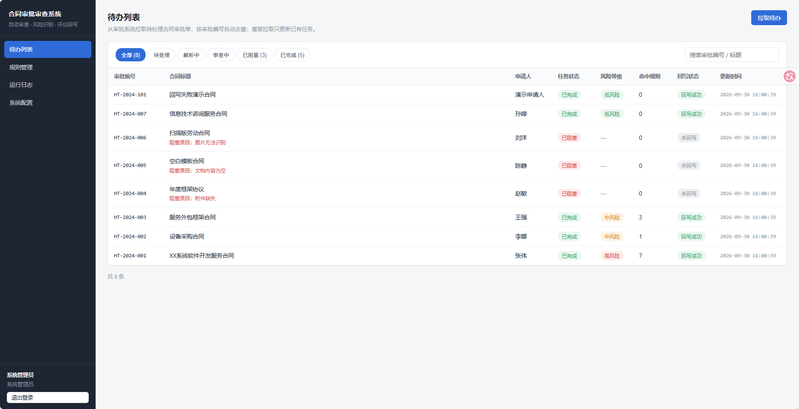
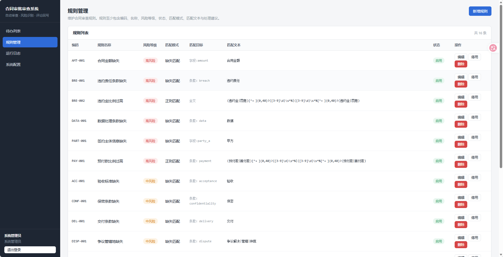
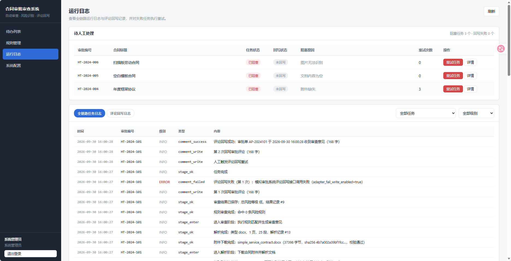
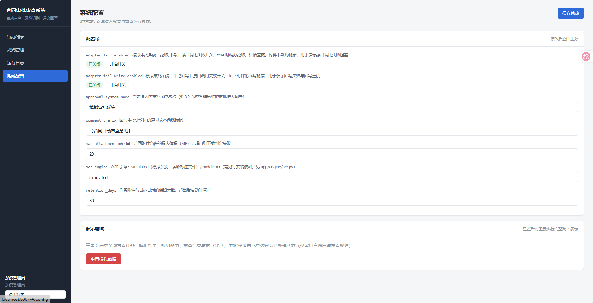

# 合同审批审查系统

面向企业合同审批场景的自动审查系统：**待办拉取 → 附件下载 → 文档解析（含扫描件 OCR）→ 规则审查 → 结果保存 → 评论回写**。

系统从审批系统拉取待处理合同审批单，按唯一业务标识去重入库，下载合同附件后解析出
结构化字段与条款信息，执行规则匹配得到风险等级、命中证据与处理建议，
最终把审查意见写回审批系统的评论区。全程不替代人工审批，只提供风险审查意见。

---

## 界面预览

| 界面 | 截图 |
| --- | --- |
| 待办列表 |  |
| 规则管理 |  |
| 运行日志 |  |
| 系统配置 |  |

---

## 一、快速开始

### 环境要求

| 依赖 | 版本 | 说明 |
| --- | --- | --- |
| Python | ≥ 3.12 | 后端服务 |
| Node.js | ≥ 18 | 仅构建前端时需要 |
| 操作系统 | Windows / Linux / macOS | 审批系统为本地模拟实现，无需外部依赖 |

### 启动方式

**方式一：一键脚本（推荐）**

```bat
:: Windows
start.bat
```

```bash
# Linux / macOS / Git Bash
./start.sh
```

脚本会自动完成：安装后端依赖 → 生成示例合同 → 构建前端（首次）→ 启动服务。

**方式二：手动启动**

```bash
# 1) 安装后端依赖（虚拟环境无 pip 时使用 uv）
uv pip install --python .venv/Scripts/python.exe -e .

# 2) 生成示例合同文件（首次或需要重置示例时）
.venv/Scripts/python.exe scripts/generate_examples.py

# 3) 构建前端（首次或前端代码有改动时）
cd frontend && npm install && npm run build && cd ..

# 4) 启动服务
.venv/Scripts/python.exe -m app.main
```

启动后访问：

| 地址 | 说明 |
| --- | --- |
| http://127.0.0.1:8003 | 前端界面 |
| http://127.0.0.1:8003/api/docs | Swagger 接口文档 |
| http://127.0.0.1:8003/api/openapi.json | OpenAPI 描述文件 |

### 首次使用

1. 打开 http://127.0.0.1:8003 ，进入登录页。
2. 点击 **「初始化系统」** 创建账户：
   - `admin` / `admin123` —— **系统管理员**：维护规则与接入配置、查看运行日志、重试失败任务
   - `reviewer` / `reviewer123` —— **法务审核人**：查看合同详情、证据定位与风险判定
3. 使用账户登录，进入待办列表页，点击 **「拉取待办」** 即可跑通完整链路。

### 前端开发模式

```bash
cd frontend && npm run dev     # http://127.0.0.1:5174，/api 自动代理到 8003
```

---

## 二、工具调用说明（§1.3.10）

7 个工具既可通过 HTTP 接口调用，也可在 Python 中直接以函数方式调用
（`from app.services import tools`）。服务层实现位于 `app/services/tools.py`。

所有 HTTP 接口都需要登录态，请求头携带 `Authorization: Bearer <token>`。

### 1. `list_pending_contract_approvals(limit)`

拉取待处理审批单列表，**并按审批编号（approval_code）去重保存**为审查任务。

| 项 | 内容 |
| --- | --- |
| HTTP | `POST /api/tools/list-pending-approvals` |
| 请求体 | `{"limit": 20}` |
| 返回 | `fetched`（拉取条数）、`created_count`（新建任务数）、`updated_count`、`skipped_count`、`items[]` |

`items[]` 每项至少包含：`approval_code`（审批编号）、`approval_title`（标题）、
`applicant_name`（申请人）、`applied_at`（申请时间）、`attachment_count`（附件数量）。

去重规则：已存在的审批编号不会新建任务；处于 `pending/parsing/reviewing` 的任务
只刷新元数据并确保在执行队列中；`blocked/done` 的任务只刷新元数据，等待人工处理。

```bash
curl -X POST http://127.0.0.1:8003/api/tools/list-pending-approvals \
  -H "Authorization: Bearer $TOKEN" -H 'Content-Type: application/json' \
  -d '{"limit": 20}'
```

### 2. `get_contract_approval(instance_id)`

查询单个审批单详情。

| 项 | 内容 |
| --- | --- |
| HTTP | `GET /api/tools/approvals/{instance_id}` |
| 返回 | `approval`（审批信息）、`form_data`（表单数据）、`attachments[]`（附件信息）、`process_status`（当前处理状态） |

`process_status` 包含 `task_status`、`write_status`、`blocked_reason`、`failure_stage`、`retry_count`；
若该审批单尚未被拉取，`task_status` 为 `not_pulled`。

### 3. `download_contract_attachment(instance_id, attachment_id, file_name)`

按审批编号与附件编号下载合同附件，返回**本地文件路径与校验信息**。

| 项 | 内容 |
| --- | --- |
| HTTP | `POST /api/tools/download-attachment` |
| 请求体 | `{"instance_id": "AP-001", "attachment_id": "ATT-001", "file_name": "contract.docx"}` |
| 返回 | `local_path`（本地路径）、`sha256`、`file_size`、`verified`（校验是否一致）、`download_status` |

附件保存在 `workspace/_downloads/{instance_id}/`；任务流程中的附件保存在 `workspace/{task_id}/`。
超过 `max_attachment_mb` 配置上限时判定为下载失败。

### 4. `parse_contract_document(document_id)`

对已下载合同执行解析，输出结构化字段、原文片段和定位信息。

| 项 | 内容 |
| --- | --- |
| HTTP | `POST /api/tools/parse-document` |
| 请求体 | `{"document_id": "DOC-0001"}` |
| 返回 | `parse_status`、`parse_type`（docx / pdf_text / pdf_ocr）、`basic_info`、`clause_info`、`parse_error` |

每个字段对象统一为：

```json
{
  "field_key": "contract_title",
  "field_name": "合同标题",
  "value": "XX系统软件开发服务合同",
  "evidence": "XX系统软件开发服务合同",
  "position": "第1页/第1段",
  "status": "found"
}
```

- `evidence` 为原文片段，`position` 为页码或位置标识（`第N页/第M段` 或 `第N页/第X条`），
  `status` 为 `found` / `missing`。
- **解析失败时返回 `parse_status=failed` 并携带 `parse_error` 失败原因，不会返回空结果。**

### 5. `run_contract_rules(case_id)`

对解析结果执行规则匹配，输出风险等级、命中证据和处理建议。`case_id` 即解析记录编号
（`contract_parses.id`，可从任务详情的 `parse.id` 获取）。命中结果写入 `rule_hits`，重复调用幂等。

| 项 | 内容 |
| --- | --- |
| HTTP | `POST /api/tools/run-rules` |
| 请求体 | `{"case_id": 1}` |
| 返回 | `overall_risk_level`、`hit_count`、`risk_counts`、`focus_points`、`hits[]`、`comment_text` |

`hits[]` 每项包含 `rule_name`（规则名称）、`risk_level`（风险等级）、`evidence_text`（命中证据）、
`evidence_position`（证据位置）、`suggestion_text`（建议说明）。

### 6. `save_review_result(case_id, overall_risk_level, summary_text, focus_points_json, comment_text)`

保存审查结果、命中规则摘要与回写内容。

| 项 | 内容 |
| --- | --- |
| HTTP | `POST /api/tools/save-review-result` |
| 请求体 | `{"case_id": 1, "overall_risk_level": "高", "summary_text": "...", "focus_points_json": "[...]", "comment_text": "..."}` |
| 返回 | `review_id`、`overall_risk_level`、`hit_count`、`comment_length` |

`overall_risk_level` 只能是 `低` / `中` / `高`。

### 7. `write_approval_comment(instance_id, review_id)`

将最终审查意见写回审批评论区，并返回回写结果。每次尝试都会记录到 `comment_logs`。

| 项 | 内容 |
| --- | --- |
| HTTP | `POST /api/tools/write-comment` |
| 请求体 | `{"instance_id": "AP-001", "review_id": 1}` |
| 返回 | `write_status`（success / failed）、`comment_preview`、`approval_comment_area` |

回写失败**不会阻塞任务**：任务仍进入 `done`，仅把回写状态置为 `failed`，
可由管理员通过 `POST /api/tasks/{id}/retry-comment` 单独重试。

---

## 三、任务状态与流转规则（§1.3.4）

### 状态定义

- **任务状态** `task_status`：`pending` → `parsing` → `reviewing` → `done`，异常进入 `blocked`
- **回写状态** `write_status`：`not_written` → `writing` → `success` / `failed`

### 流转图

```
拉取待办 ──► pending ──► parsing ──► reviewing ──► done
                           │             │
                           └──► blocked ◄┘
                                 │
                        人工重试 └──► 回到 parsing 或 reviewing
```

### 阻塞原因与重试入口

| 阻塞原因 | 触发时机 | 失败阶段 | 重试入口 |
| --- | --- | --- | --- |
| 附件缺失 | 审批单未提供任何合同附件，或附件写入本地失败 | `download` | 重新进入 `parsing` |
| 接口调用失败 | 审批系统详情 / 附件下载接口调用异常 | `download` | 重新进入 `parsing` |
| 文档内容为空 | 文档无有效文本内容（含空模板） | `parse` | 重新进入 `parsing` |
| 图片无法识别 | 扫描件经 OCR 未识别出任何文本 | `parse` | 重新进入 `parsing` |
| 解析结果缺失 / 审查异常 | 审查阶段缺少可用解析结果或发生未预期异常 | `review` | 重新进入 `reviewing` |

重试接口：`POST /api/tasks/{task_id}/retry`（仅系统管理员，仅 `blocked` 状态可用）。
所有状态流转都会写入 `task_logs`，记录类型包括 `pull_created`、`stage_enter`、`stage_ok`、
`blocked`、`retry`、`comment_write`、`comment_success`、`comment_failed`。

---

## 四、数据表（§1.3.9）

| 表名 | 说明 |
| --- | --- |
| `approval_tasks` | 审查任务，按 `approval_code` 唯一去重；含任务状态、回写状态、阻塞原因、失败阶段、重试次数 |
| `approval_attachments` | 附件下载记录，含本地路径、sha256、文件大小、下载状态 |
| `contract_parses` | 合同解析结果，含基本信息 JSON、条款 JSON、解析状态与失败原因 |
| `review_rules` | 审查规则，含编码、名称、风险等级、状态、匹配模式、匹配文本、建议说明 |
| `rule_hits` | 规则命中记录，含命中证据、证据位置、命中状态及规则快照 |
| `review_results` | 审查结果，含总风险等级、中文摘要、审批关注点、回写内容 |
| `comment_logs` | 评论回写日志，记录每次回写尝试的状态与响应 |
| `task_logs` | 全链路日志，含日志级别、日志类型与内容 |

初始化脚本：`scripts/init_db.sql`（幂等，服务启动时自动执行）。
另有支撑表 `users`、`sessions`、`system_configs` 与模拟审批系统的
`mock_approvals`、`mock_approval_attachments`。

---

## 五、服务模块（§1.3.8）

| 模块 | 实现位置 | 职责 |
| --- | --- | --- |
| 拉取模块 | `app/approval_adapter.py` + `app/pipeline.py::pull_pending` | 拉取待处理审批单并按唯一业务标识去重保存 |
| 附件模块 | `app/pipeline.py::_download_attachment` | 附件下载、本地存储、附件元数据与校验信息保存 |
| 解析模块 | `app/engine/document.py`、`ocr.py`、`fields.py` | 文档解析、图片识别、字段与条款提取 |
| 规则模块 | `app/engine/rules.py`、`aggregate.py` | 规则匹配、命中生成、风险汇总与回写文本生成 |
| 回写模块 | `app/pipeline.py::write_comment` | 生成评论内容、写回审批评论区、保存回写日志 |
| 日志模块 | `app/pipeline.py::log_task` | 全链路日志落库（`task_logs`）并同步落文件（`runtime_logs/{task_id}/task.log`） |

服务与审批系统之间通过 `ApprovalAdapter` 接口解耦，默认实现为基于本地模拟审批表的
`MockApprovalAdapter`。**对接真实审批系统时**，只需在 `app/approval_adapter.py` 中
实现同一套接口（`fetch_pending` / `fetch_detail` / `fetch_attachment` / `write_comment`）
并在 `get_adapter()` 中返回新实现，上层流水线与工具服务无需改动。

---

## 六、合同解析字段（§1.3.5）

- **基本信息 8 项**：合同标题、合同编号、签约主体、对方名称、金额、币种、生效时间、到期时间
- **条款信息 8 类**：付款条款、交付条款、验收条款、违约条款、保密条款、数据条款、知识产权条款、争议解决条款

每个字段均保留 `value`（取值）、`evidence`（原文片段）、`position`（页码或位置标识）、
`status`（found / missing）。条款定位优先使用条款编号（`第N页/第X条`），
无编号时回退到段落序号（`第N页/第M段`）。

支持的文件类型：

| 类型 | 解析方式 | `parse_type` |
| --- | --- | --- |
| `.docx` | python-docx 段落提取 | `docx` |
| 文本型 PDF | PyMuPDF 文本层提取 | `pdf_text` |
| 扫描型 PDF | 逐页渲染为图像后交由 OCR 引擎识别 | `pdf_ocr` |

---

## 七、审查规则（§1.3.6）

规则表 `review_rules` 字段：`rule_code`、`rule_name`、`risk_level`、`rule_status`、
`match_mode`、`match_text`、`suggestion_text`，另有扩展字段 `match_target` 指定匹配对象。

**三种匹配模式**：

- `regex` —— 正则匹配，命中即产生风险
- `contains` —— 包含匹配（`match_text` 用 `|` 分隔多个候选词）
- `missing` —— 缺失匹配，目标条款/字段未提取到时产生风险

**匹配对象 `match_target`**：`full_text`（全文逐段检索）/ `clause:{key}`（某类条款）/ `field:{key}`（某个字段）。

内置 16 条规则，覆盖预付款比例、付款周期、一次性付款、自动续约、违约责任、违约金比例、
争议管辖地、管辖地不利、主体信息缺失、金额缺失、币种未明确、保密缺失、数据处理、
知识产权、验收标准缺失、交付条款缺失。可在「规则管理」页维护，或在任务详情页把命中
标记为误报（总风险等级随之重算）。

---

## 八、OCR 引擎接入

默认使用内置 `SimulatedOCR`：读取示例扫描件随附的标注文件
`examples/contracts/ocr_labels/{文件名}.page{N}.txt` 作为识别结果，
使「扫描件 → 识别 → 字段提取 → 规则审查」链路可离线、确定性地跑通。
缺少标注文件即视为识别失败，用于演示「图片无法识别」阻塞。

接入真实 OCR 引擎（PaddleOCR / EasyOCR / 云服务）只需在 `app/engine/ocr.py` 中新增
`OCREngine` 子类并实现 `recognize(image, page_no, document_slug)`，然后：

```bash
# 1) 安装引擎依赖，例如
uv pip install --python .venv/Scripts/python.exe paddleocr

# 2) 在 app/engine/ocr.py 中补充子类实现（文件头有完整示例）

# 3) 在「系统配置」页把 ocr_engine 改为 paddleocr，或在库中直接更新配置：
#    UPDATE system_configs SET config_value='paddleocr' WHERE config_key='ocr_engine';
```

---

## 九、完整演示

### 方式一：浏览器手动演示

1. 打开 http://127.0.0.1:8003 ，登录页点击「初始化系统」，用 `admin` / `admin123` 登录。
2. **待办列表** —— 点击「拉取待办」，系统拉取 7 条待处理审批单并自动开始处理；
   列表实时显示任务状态、风险等级、命中规则数与回写状态。
3. **任务详情** —— 点击任意任务，可看到四个功能模块：
   - *审批信息与附件*：审批信息、表单数据、附件（含 sha256 校验与本地路径）
   - *合同解析结果*：8 项基本信息与 8 类条款，每项含取值、原文片段、位置与提取状态
   - *规则命中*：命中的规则名称、风险等级、命中证据、证据位置与处理建议
   - *审查结果与评论回写*：总风险等级、中文摘要、审批关注点、回写内容与回写状态
4. **运行日志 / 规则管理 / 系统配置** —— 管理员可查看全链路日志、重试失败任务、
   维护审查规则、调整审批接入配置。

### 方式二：无头演示脚本

```bash
# 完整闭环演示（需先启动后端服务）
.venv/Scripts/python.exe demo/run_demo.py

# 保留现有数据，不重置演示环境
.venv/Scripts/python.exe demo/run_demo.py --keep
```

演示覆盖：待办拉取与去重 → 四个正常合同（高/中/低风险，含扫描件 OCR）与三类解析期阻塞 →
高风险合同详情走查 → 评论回写核验 → 7 个工具接口逐一调用 → 重复拉取去重 →
阻塞任务重试 → 接口调用失败阻塞与恢复 → 评论回写失败与重试。

### 方式三：验收自检

```bash
.venv/Scripts/python.exe demo/verify.py
```

逐项核对需求文档的可验证条目（数据表结构、工具接口、解析字段、规则覆盖、输出格式、
回写闭环、异常阻塞与重试、去重与权限）。预期输出：`通过 73 / 73`。

### 方式四：前端界面自动化检查（可选）

```bash
uv pip install --python .venv/Scripts/python.exe playwright   # 复用本机浏览器
.venv/Scripts/python.exe demo/ui_check.py                     # 截图保存至 demo/screenshots/
```

逐页访问并截图，检查各功能模块渲染与控制台错误，预期输出：`通过 27 / 27`。

---

## 十、目录结构

```
star-contract-review/
├── app/
│   ├── main.py               # 服务入口：建库、播种、路由挂载、前端静态资源
│   ├── config.py             # 目录布局与系统配置项
│   ├── db.py                 # SQLite 数据访问层（WAL + 每操作独立连接 + 写锁）
│   ├── auth.py / security.py # 登录态与密码哈希
│   ├── schemas.py            # 请求模型
│   ├── seed.py               # 种子数据：16 条规则 + 7 条模拟审批单
│   ├── approval_adapter.py   # 审批系统适配层（对接真实系统的扩展点）
│   ├── pipeline.py           # 任务流水线与状态机
│   ├── services/tools.py     # 7 个工具函数
│   ├── engine/               # 解析、OCR、字段提取、规则匹配、风险汇总
│   └── routers/              # system / tasks / tools / rules / logs 路由
├── scripts/
│   ├── init_db.sql           # 数据库初始化脚本（幂等）
│   └── generate_examples.py  # 示例合同生成脚本
├── examples/contracts/       # 示例合同（docx / 文本 PDF / 扫描件）与 OCR 标注
├── demo/
│   ├── run_demo.py           # 完整闭环演示
│   ├── verify.py             # 验收自检
│   └── ui_check.py           # 前端界面自动化检查
├── frontend/                 # React 18 + Vite 5 前端（构建产物由后端同端口服务）
├── data/                     # SQLite 数据库（运行时生成）
├── workspace/                # 附件与临时文件（运行时生成）
├── runtime_logs/             # 任务日志文件（运行时生成）
├── start.bat / start.sh      # 一键启动脚本
└── pyproject.toml
```

---

## 十一、常见问题

**端口 8003 被占用？**
修改 `app/main.py` 中 `run()` 的端口，并同步修改 `frontend/vite.config.js` 的代理目标。

**「拉取待办」提示接口调用失败？**
检查「系统配置」页的 `adapter_fail_enabled` 是否为 `true`（该开关用于演示接口调用失败场景），
关闭后重试即可。

**任务显示「图片无法识别」？**
该扫描件没有对应的 OCR 标注文件。使用内置模拟 OCR 时，需要在
`examples/contracts/ocr_labels/` 下提供 `{文件名}.page{N}.txt` 标注，或接入真实 OCR 引擎。

**前端页面空白？**
前端尚未构建，执行 `cd frontend && npm install && npm run build`，或直接运行 `start.bat`。
